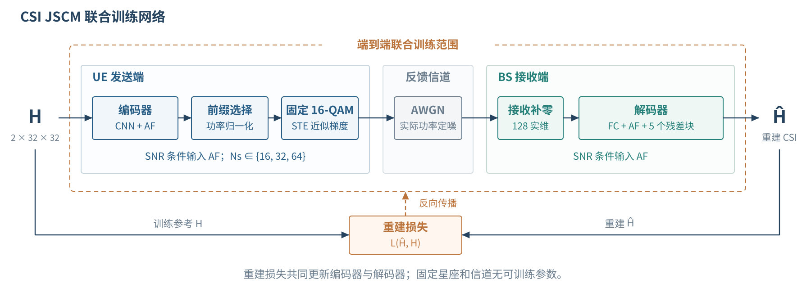
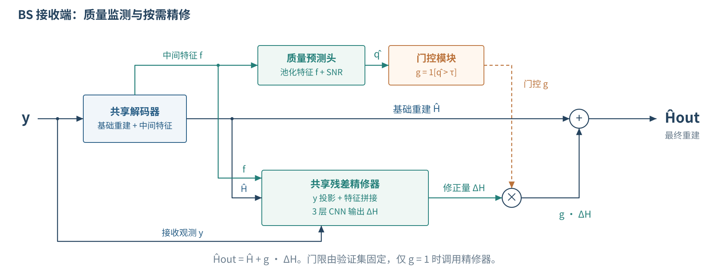

# CSI JSCM：共享模型与接收端质量判断

面向有噪 CSI 反馈的联合信源信道编码与调制研究，包含模型实现、训练脚本、实验结果和复现说明。

研究围绕同一条有限星座反馈链路展开：

- **Q1：共享模型的代价在哪里，如何降低？** 比较跨 SNR 共享与专用模型，评估蒸馏、损失重加权、BN 条件重标定及 GN 结构对照。
- **Q2：单次反馈质量如何判断，判断后如何处理？** 比较 UE 代理与 BS 质量头，评估选择性精修、UE 预检后的重复发送，以及接收机更新对后续模块的影响。

后期实现基于 **RD-JSCC 自编码器结构的 PyTorch 改编**，加入固定 16-QAM 和多反馈长度。研究聚焦自编码器反馈链路及接收端处理，不包含官方 VQ 与扩散模块。

## 网络结构

### JSCM 联合训练网络

UE 将 CSI 编码为有限星座符号，经有噪反馈信道传输，BS 完成重建。重建损失共同训练编码器和解码器，固定 QAM 映射通过 STE 传递近似梯度。



后期模型最多发送 64 个复符号，支持 `Ns ∈ {16, 32, 64}`，训练覆盖反馈 SNR 0–20 dB。AF 使用 SNR 条件信息；发射功率在星座映射后测量。

Q1 先比较各条件下的平均重建误差，检验训练目标和 BN 统计量调整的作用。Q2 接着利用共享解码器的输出和特征，判断同一条件下每次反馈的质量。

### BS 质量判断与本地精修

基础解码器输出重建 CSI 和特征，小型质量头预测误差；按验证集确定的门限，选择直接使用或调用共享残差精修器。



质量头和精修器在基础模型冻结后训练，运行时 BS 使用接收观测与特征，不需要真实 H。本地精修只增加 BS 计算；另设 UE 预检后由 BS 选择重复发送的实验，比较追加反馈资源的效果。

调整解码器 BN 后，再检查质量头、触发门限和精修器，评估 Q1 的改动对 Q2 的影响。详细设计见 [研究流程](docs/METHOD.md)。

## 阅读导航

| 内容 | 入口 |
|---|---|
| 场景、联合训练与两个问题的联系 | [研究流程](docs/METHOD.md) |
| 主要结果及实验条件 | [结果说明](docs/RESULTS.md) |
| 最新 Q1 实验与运行顺序 | [补充实验索引](docs/RECENT_EXPERIMENTS.md) |
| 对照公式阅读实现 | [代码导读](docs/study/03_主要代码导读.md)、[公式推导](docs/study/04_公式推导与代码对应.md) |
| 环境安装与运行顺序 | [复现说明](docs/REPRODUCING.md) |
| 引用与改编来源 | [文献及第三方来源](THIRD_PARTY_NOTICES.md) |

## 快速开始

建议 Python 3.12。先安装适合自己设备的 PyTorch，再安装其余依赖：

```bash
python -m venv .venv
# Windows PowerShell: .venv\Scripts\Activate.ps1
# Linux/macOS: source .venv/bin/activate
python -m pip install torch --index-url https://download.pytorch.org/whl/cpu
python -m pip install -r requirements.txt

# 检查链路、STE 梯度和接收端 BN 重统计
python scripts/smoke_check.py
python scripts/smoke_recent.py

# 读取已有 BN / GN 三种子结果
python scripts/show_results.py

# 使用小型合成数据运行一轮训练
python scripts/run.py --run-dir runs/demo generate --small
python scripts/run.py --run-dir runs/demo train bn --smoke
```

新生成的数据、权重及实验产物保存在 `runs/`；已有实验结果位于 `results/`。完整训练与评估命令见 [复现说明](docs/REPRODUCING.md)。

## 目录

```text
simulation/    核心链路、训练、蒸馏、BN 与历史探索脚本
experiments/   按研究问题分组的实验脚本
results/       实验 JSON、协议、报告和结果图
docs/          研究流程、公式推导、代码导读与复现说明
scripts/       运行入口、链路检查、结果读取和本地资产导入
runs/          新运行的输出，默认不提交
```

## 主要结果

- **共享代价：** 前期 64 实符号模型的差距集中在低 SNR。蒸馏和重加权能够改善低 SNR，但伴随中高 SNR 的性能取舍。
- **训练策略：** 后期含 BN 的 RD-AE 固定 `Ns=64` 对照中，重加权将 0 dB 共享差距从 **0.370 缩至 0.032 dB**，20 dB 有退步；单种子结果。共享起点蒸馏相对同预算普通微调没有稳定额外优势。
- **GN 与输出校准：** 新的固定长度、逐样本 SNR 对照中，GN 在 0 dB 仍有约 **0.311 dB** 共享差距。输出仿射在这组 GN 上基本无效；前期 CNN 的约0.47 dB NMSE收益不改变 SGCS，不能外推为方向或吞吐改善。
- **BN 与 GN：** 后期统一评估中，`Ns=16`、10/20 dB 时，目标重标定 BN 比 GN 分别好约 **0.203/0.221 dB**；`Ns=64` 中高 SNR 时，GN 均值略优。
- **质量判断：** BS 质量头利用解码特征优于直接输入 y；当前配置下，UE 代理的判断更准确。
- **选择性处理：** 本地精修和 UE 预检后的重复发送在特定条件下减少超门限样本，收益随处理动作、SNR 和评价目标变化。
- **模块联动：** 主解码器 BN 改变后，旧质量头、门限与精修器需要重新评估。

实验基于合成 CSI 与 AWGN。两阶段的骨干、符号维度和部分指标汇总不同，分别报告结果；具体采样、种子、统计方法和适用范围见 [结果说明](docs/RESULTS.md)。

## 数据与代码来源

仓库提供合成数据生成器和实验结果摘要。预训练权重与中间缓存按需导入，使用方法见 [复现说明](docs/REPRODUCING.md)。

RD-JSCC 等工作的引用、改编范围和许可说明见 [THIRD_PARTY_NOTICES.md](THIRD_PARTY_NOTICES.md)。
