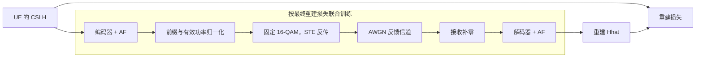
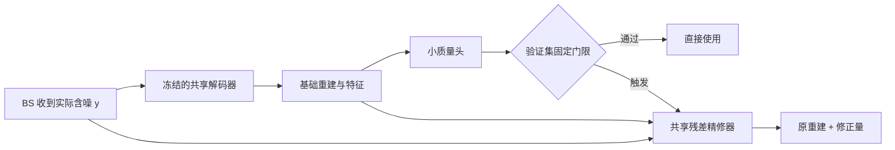

# 场景、训练与两个研究问题

## 场景

FDD 大规模 MIMO 中，UE 估计下行 CSI，经有噪上行反馈交给 BS 做重建。主实验假设 UE 具有理想 CSI、反馈为 AWGN。为减少模型存储，尝试部署跨 0–20 dB 的共享模型。

Q1 先研究条件平均性能。Q2 在同一条链路后研究单次接收质量与处理。改变解码器 BN 后再检查质量头和精修器，把两问接起来。

## 联合训练链路

固定 QAM 与 AWGN 没有可训练参数；编码器选择哪些符号仍受最终损失影响。STE 的前向为硬映射，反向使用近似梯度，不是对硬量化真实求导。

后期张量：`H: B×2×32×32`，编码向量 `B×128`，对应最多 64 个复符号。`Ns∈{16,32,64}`。未发送位置不计功率、不加有效噪声，解码前补零。每个复符号的噪声功率为 `Ptx / 10^(SNR/10)`，I/Q 各一半。功率在量化映射后测量。

原训练代码默认逐样本抽 SNR，但 Ns **每 batch 抽一个**。后续部分校准按逐样本混合 Ns；两者不能被描述为完全相同的混合统计协议。`cond=False` 只关闭额外拼接标量，AF 条件输入仍在。

## Q1

1. 前期 64 实符号模型：共享与 0/10/20 dB 专用库比较，随后统一学生协议比较重建、重加权与蒸馏。
2. 后期 RD-AE 改编：固定权重，比较原始 BN、混合重统计、目标条件重统计。
3. 扩展：0/20 dB 稀疏锚点插值、接收端 SNR 偏差与保守混合、最新 BN/GN 统一评估。

GN 对照替换编码器和解码器共 18 层，是两端结构对照。BN-S0/S2 则固定同一套权重和同一个 y，只改接收端统计量。两种对照不能混称“只改接收端归一化”。

## Q2

基础模型训练完后冻结，质量头由真实逐样本误差监督，精修器由重建目标训练。运行时 BS 只用 y、特征和条件，没有 H；UE 有 H，却没有此次反馈噪声。联合训练不会消除两端的信息差别。

本地精修不再发任何符号。另一个独立设置先由 UE 代理排除预计较差者，再由 BS 在同一通过集合中选择一次重复发送；随机对照匹配追加次数。重复仅改变噪声，不能增加新的压缩信息。

离线按池排序选 20% 是资源诊断，逐条固定门限是另一个运行方式。不能假设实际反馈必须同时凑齐几百条，或把未模拟的 UE 拒绝者回退、控制误码、RTT、老化视为已实现。
