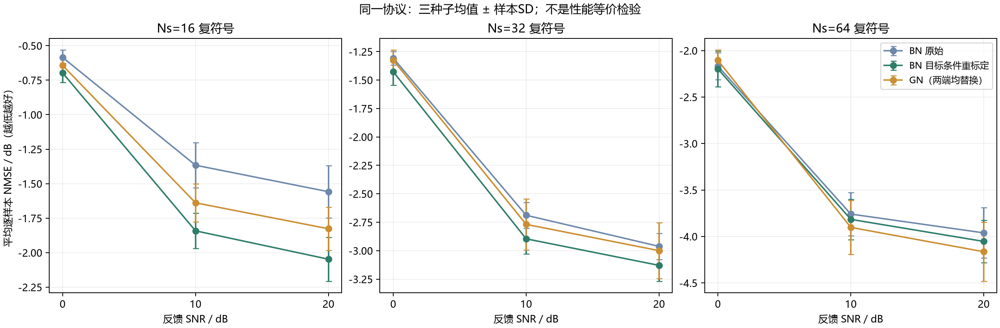

# 实验结果与适用范围

结果文件是历史产物，本次整理没有重跑完整科研实验。这里将可引用的结论和对应证据集中列出。完整数字见链接，代码与报告分开保存。

## 两阶段不能混为同一个模型

| 项目 | 阶段 A | 阶段 B |
|---|---|---|
| 骨干 | 自建 CNN，另有 CsiNet 风格对照 | RD-JSCC AE 结构改编 |
| 调制 | 64 实符号，学习的 16 点实数星座 | 固定 16-QAM，16/32/64 复符号 |
| 主要 NMSE 汇总 | 先平均线性 NMSE，再转 dB | 平均逐样本 NMSE_dB |
| 研究内容 | 初始消融、共享代价、蒸馏、BN | 多长度 BN、GN、监测与后续处理 |

个别阶段 A 诊断采用逐样本 dB 平均，必须按各表标注解读。不能把共享缺口与另一协议的 BN 改善直接相减。

## Q1：共享代价与改善

| 观察 | 证据 | 能说什么 |
|---|---|---|
| 前期共享缺口集中于低 SNR | [阶段 A 重评](../results/stage_a/results_v2_eval.json) | 0/2 dB 约 0.69/0.29 dB，4–20 dB 绝对差约不超过 0.12 dB；专用库取最近锚点 |
| 蒸馏存在取舍 | [匹配训练对照](../results/stage_a/results_v3_distill.json) | λ=1 在 0 dB 好约 0.37 dB，10/20 dB 差约 0.17/0.26 dB；简单加权同样偏向低 SNR |
| 目标 BN 有受限收益 | [BN 与小规模适配](../results/extra_experiments_20261113/q1_results.json) | 不同部署点幅度不同，混合重统计本身也可能改善 |
| 少量锚点可近似逐点校准 | [稀疏锚点](../results/deployment_followup_20261113/q1_anchor_results.json) | 0/20 dB 插值到 5/10/15 dB，各条件三种子均值的最大差约 0.013 dB |
| 条件估计误差下可保守混合 | [SNR 偏差](../results/q1_snr_uncertainty_20261114/summary.json) | 验证集选择混合系数；不是新 SNR 估计器，也不是未见场景保证 |

### 最新统一 BN / GN 对照

来源：[完整报告](../results/gn_bn_unified_20261114/统一协议比较结果.md)、[JSON](../results/gn_bn_unified_20261114/results.json)、[协议](../results/gn_bn_unified_20261114/protocol.json)。使用当前修正版 BN/GN 权重，6000 训练 H 校准，1000 测试 H×3 新噪声，3 训练种子。均值如下，越负越好：

| Ns | SNR/dB | 原始 BN | 目标 BN | GN | 目标 BN 相对 GN 改善/dB |
|---|---|---|---|---|---|
| 16 | 0 | −0.5852 | −0.6973 | −0.6431 | +0.0542 |
| 16 | 10 | −1.3664 | −1.8417 | −1.6388 | +0.2029 |
| 16 | 20 | −1.5582 | −2.0474 | −1.8267 | +0.2206 |
| 32 | 0 | −1.3073 | −1.4272 | −1.3257 | +0.1015 |
| 32 | 10 | −2.6887 | −2.8958 | −2.7685 | +0.1273 |
| 32 | 20 | −2.9622 | −3.1293 | −2.9998 | +0.1294 |
| 64 | 0 | −2.1672 | −2.1971 | −2.1043 | +0.0929 |
| 64 | 10 | −3.7590 | −3.8160 | −3.9025 | −0.0865 |
| 64 | 20 | −3.9612 | −4.0533 | −4.1642 | −0.1109 |

`Ns=16` 的 10/20 dB，GN 自身比原始 BN 好约 0.27 dB，目标 BN 再好约 0.20/0.22 dB；三种子方向一致，平方 SGCS 同向。配对三种子 t 区间分别约 [0.015,0.391]、[0.018,0.424] dB，未做多重比较校正，属于探索性证据。

其余条件不能套用上述强度。尤其全长中高 SNR，GN 均值略好且种子方向不一致。该组三种子多长度对照未训练 GN 专用库，不是“所有归一化方法的共享代价”比较。后续独立的固定长度 GN 专用对照见下一节；未测 LN/GDN 或其他 GN 分组。

### RD-AE 固定 Ns=64 的单种子补充

[单种子结果](../results/rdae_q1_supplement/results.json)与[解释](../results/rdae_q1_supplement/本轮结论与学习补充.md)只验证固定长度跨 SNR，共享代价约为 0.370/0.130/0.088 dB；重加权在低 SNR 有收益，λ=1 蒸馏变差。不能与多长度旧权重拼接，也不当作三种子主结论。

### 11月15–16日补充对照

代码、结果链接与完整运行顺序见 [补充实验索引](RECENT_EXPERIMENTS.md)。

| 新增对照 | 主要观察 | 需要保留的限定 |
|---|---|---|
| 含 BN 的 RD-AE 重加权 | 0 dB 差距0.370→0.032 dB，20 dB有退步 | 固定Ns64、单种子，不代表整体追平 |
| 从共享权重微调 | 蒸馏0 dB改善0.067 dB，普通继续训练0.056 dB | 额外约0.011 dB，配对区间跨零 |
| Ns 分配方式 | 20 dB、Ns16原始NMSE：逐批次−1.973、逐样本−1.916；Ns64为−3.604、−3.810 | 两组SNR均逐样本；单种子，只变Ns分配，没有专用模型 |
| CNN 输出幅度校准 | 0 dB仅缩放改善0.472 dB，SGCS不变；同口径双方校准后差距0.823→0.347 dB | 三种子；不同于旧共享曲线口径，不能拿0.69直接相减 |
| GN 固定Ns64共享/专用 | 0/10/20 dB差距+0.311/−0.055/−0.032 dB | 同初始化、数据顺序与标准噪声、同40轮；一个训练种子 |
| GN 输出仿射 | 0 dB双方仿射后差距约0.310 dB，共享输出基本不改善 | 前期CNN收益不能外推；线性MSE拟合不保证均值dB最优 |

新 GN 的 0 dB 平方 SGCS 为共享0.385、专用0.428，表明该点也有方向差距。GN没有BN运行统计量且SNR逐样本抽取，仍存在共享差距；这排除了BN失配是差距的必要条件，但不能证明剩余差距由容量造成。

由这些实验给出的建议是：先明确目标SNR、反馈长度和评价指标，再用匹配对照选择训练策略。模型固定后，可以检验低成本校准，收益以目标条件下的验证结果为准。平均性能调整后，再研究单次反馈质量与后续处理。

## Q2：判断质量之后，动作是否有效

| 观察 | 证据 | 主要限制 |
|---|---|---|
| BS 解码特征优于直接 y 的小头 | [输入对照](../results/extra_experiments_20261113/q2_results.json) | 特征是 y 的确定性变换，没有新增观测信息 |
| UE 代理在当前配置更准 | [单次代理对照](../results/guo_proxy_experiments_20261113/Guo式代理对照结果.md) | UE/BS 的输入和算力不同，不是严格同架构消融，也不是 Guo 官方复现 |
| 按差精修减少部分尾部风险 | [精修报告](../results/q2_refinement_followup_20261113/坏样本精修后续结果.md) | 20 dB 比同 MAC 随机少约 1.19 个百分点越限；汇总平均 NMSE 反而差约 0.020 dB |
| UE 先预检后，BS 选择重复有低 SNR 作用 | [相对随机的主问题结果](../results/q2_ue_screen_bs_retry_20261113/UE筛选后BS相对随机_主问题结果.md) | 0 dB 越限比例 12.02%→10.68%；中高 SNR 未见稳定优势，未计 RTT/老化/真实控制误码 |
| 改主解码器后，下游要复查 | [接收端维护](../results/joint_receiver_maintenance_20261113/summary.json)、[等预算继续训练对照](../results/joint_receiver_maintenance_20261113/继续训练对照.md) | BN 改善基础误差，但旧门限使精修调用率漂移；离线更新使用有真值数据，并非免监督在线训练 |

坏门限来自验证分位数，不是标准业务中断线。平均 NMSE、SGCS、越限比例和实际吞吐是不同目标；本项目没有实现完整预编码、吞吐或硬件链路闭环。

## 历史记录怎么用

`results/`保留消融和负结果，不等于每份早期记录都具有相同结论地位。双侧提示融合、单侧决策、早期小精修器等放在对应目录作为探索过程。旧版约 +0.18 dB 的星座收益已被功率对齐后的结果修正；作废的旧 `results.json`、`results_rdae.json` 没有放入主结果目录。

报告里的 SHA256 和审计 PASS 是历史运行的来源证据，不能替代对当前发布代码的检验。路径文本已整理，原始哈希不会自动变成编辑后代码的哈希；详见 [整理说明](PACKAGING.md)。
