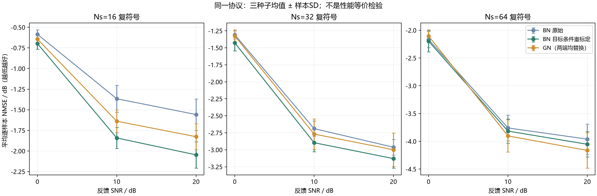
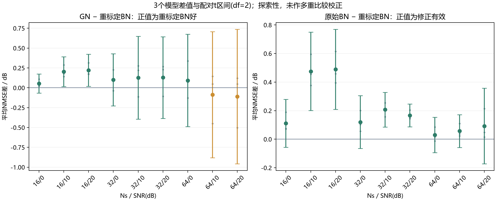

# 统一评估后的结论

本轮没有重训，比较现有BN与GN三种子；用同一完整test1000H×3组噪声。没有沿用已经作废的旧BN JSON，也没有混用NMSE公式。

## 直接回答：重标定BN是否比GN好

| Ns | SNR | GN−BN-S2 / dB | 三种子是否都支持同一方向 | 配对种子95%区间 |
|---|---|---|---|---|
| 16 | 0 | +0.0542 | 三者均为BN-S2好 | [-0.0649, +0.1733] |
| 16 | 10 | +0.2029 | 三者均为BN-S2好 | [+0.0149, +0.3909] |
| 16 | 20 | +0.2206 | 三者均为BN-S2好 | [+0.0176, +0.4237] |
| 32 | 0 | +0.1015 | 方向不一致 | [-0.2272, +0.4303] |
| 32 | 10 | +0.1273 | 方向不一致 | [-0.3949, +0.6495] |
| 32 | 20 | +0.1294 | 方向不一致 | [-0.3846, +0.6434] |
| 64 | 0 | +0.0929 | 方向不一致 | [-0.4883, +0.6740] |
| 64 | 10 | -0.0865 | 方向不一致 | [-0.8795, +0.7064] |
| 64 | 20 | -0.1109 | 方向不一致 | [-0.9582, +0.7364] |

9个条件中，BN-S2在7个条件的均值优于GN，GN在2个条件更好。格子数量不是统计显著性或真实部署流量加权收益。

## 这能支持什么

- 按具体Ns/SNR报告结构替换与条件校准的选择，不预设重标定BN一定赢。
- 直接比较BN-S2与GN，不从GN≈BN-S0间接推导。
- 若区间跨0，表示证据不足以排除方向变化，不表示已经证明两者等价。
- 若区间不跨0，仍仅是3种子、9条件的探索性证据；没有多重比较校正。
- GN两端替换改变编码器和解码器；不是只删去一个接收端失配源，也不代表所有LN/GDN方案。
- 是否降低共享代价仍需相应专用模型参照，此处衡量的是现有共享模型性能。

完整表格和指标见统一协议比较结果.md。原始文件完整性及81个模型评估的独立复核均为PASS。

