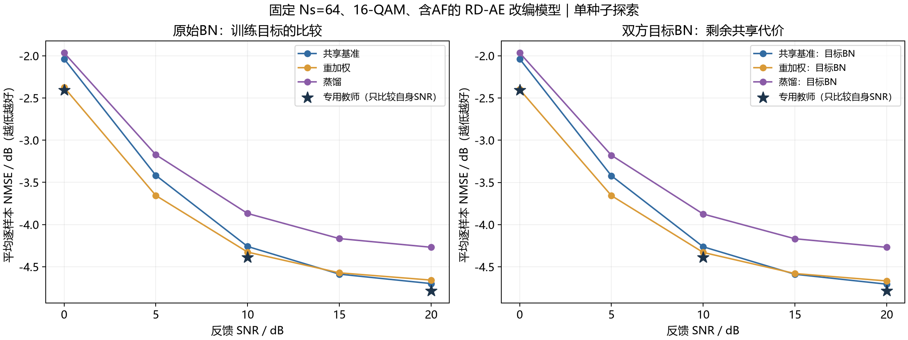
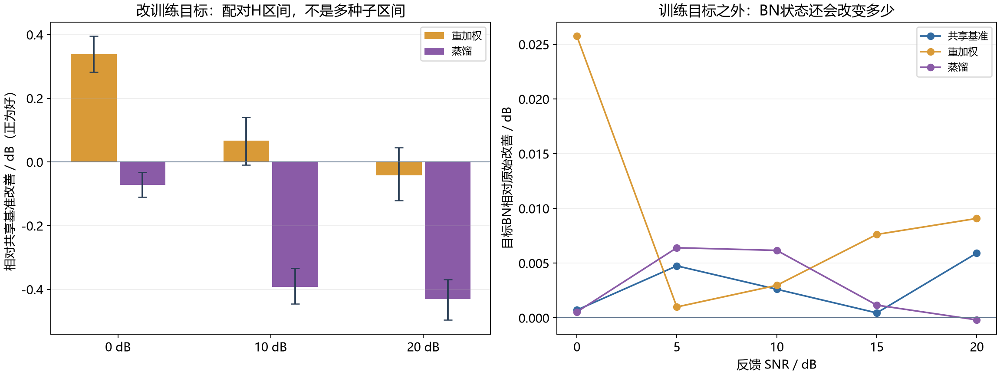

# 如何解读这次单种子补实验

先看同骨干同预算的专用—共享差距，再看训练目标和 BN。这里没有将旧多长度模型与新固定长度模型混在一起。

## 1. 这个共享模型有没有代价

| SNR | 原始共享−原始专用/dB | 目标BN共享−目标BN专用/dB |
|---|---|---|
| 0 | +0.3704 | +0.3683 |
| 10 | +0.1296 | +0.1256 |
| 20 | +0.0878 | +0.0808 |

正值表示共享较差；负值表示在这个单种子预算下共享反而更好。共享可能因跨条件训练的正则化或优化差异而赢，不应预设专用必然占优。

## 2. 重加权和蒸馏是否全面有效

| SNR | 重加权相对共享/dB | 蒸馏相对共享/dB |
|---|---|---|
| 0 | +0.3380 | -0.0718 |
| 10 | +0.0667 | -0.3913 |
| 20 | -0.0414 | -0.4306 |

正值为改善；逐点看有无权衡，不用三点平均掩盖单点退化。配对H区间在 results.json，不表示训练种子稳定性。

## 3. 能否写进答辩

可以作为附录中的同骨干探索性验证。若需要把它升为主结论，至少增加独立训练种子；不得把一次训练的差异当成普遍共享代价或确定的方法收益。

本轮不自动改 PPT、旧权重或历史结论；最终采用哪条表述应由完整结果决定。

